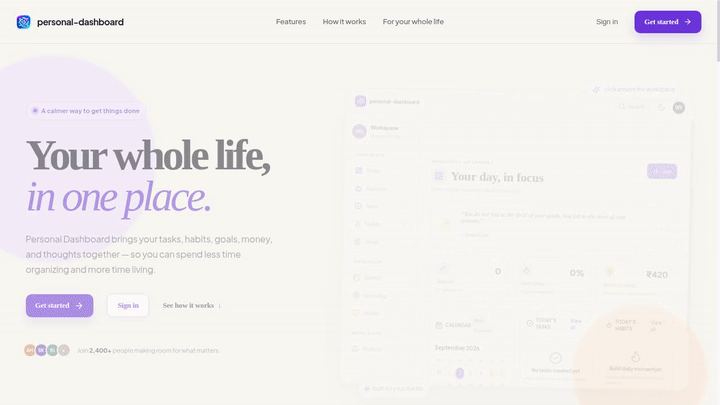
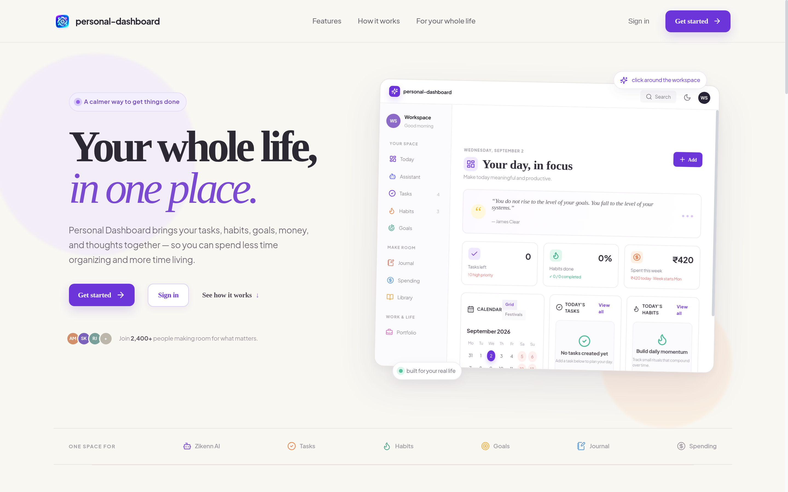
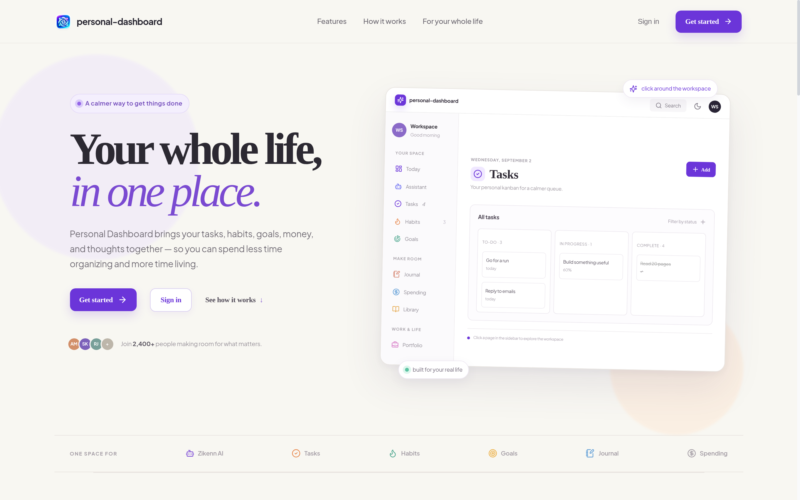
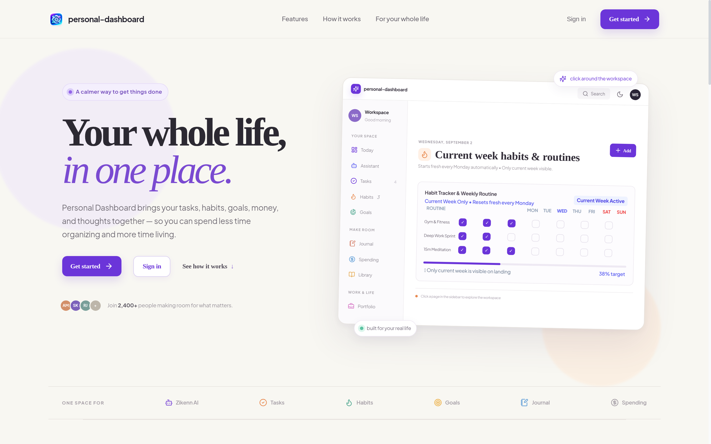
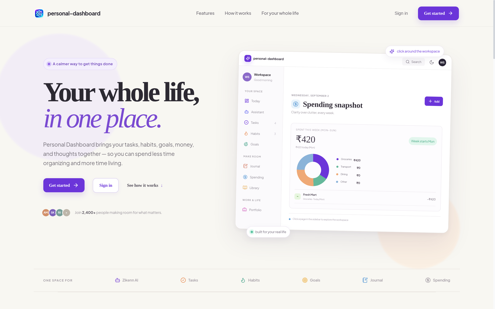
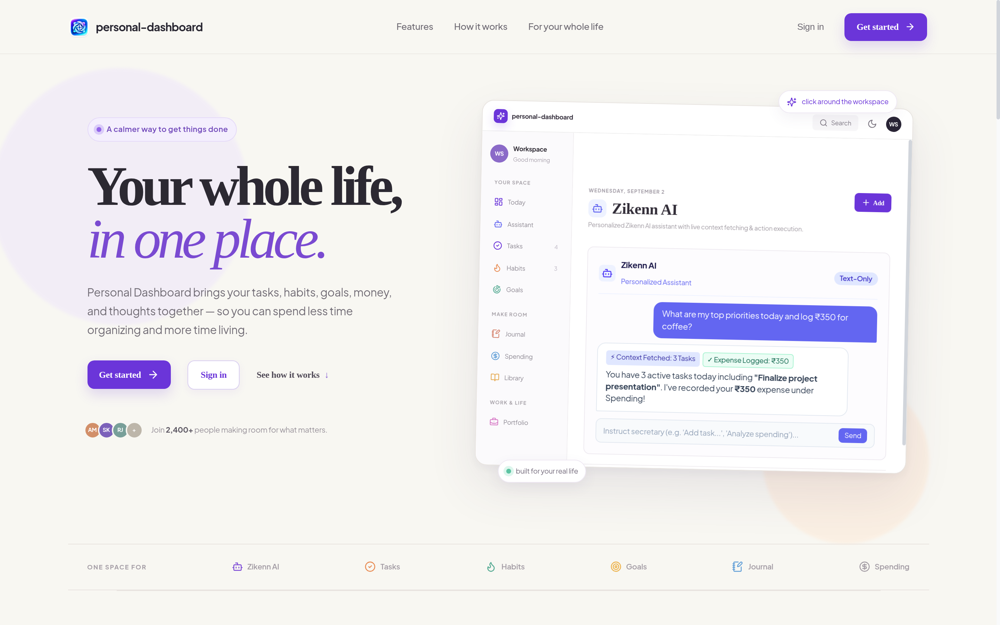
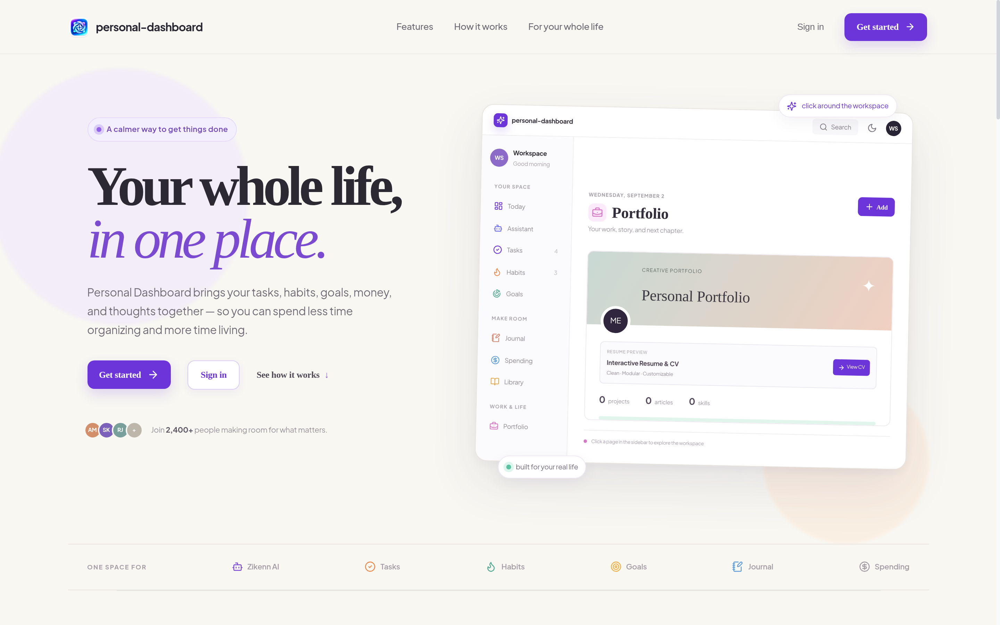
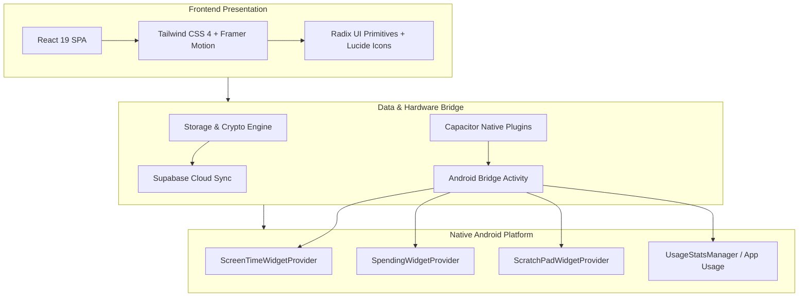

<div align="center">

# ⚡ Zikenn Dashboard
### **Your life. Your ambitions. One command center.**

Bring your productivity, finances, career, learning, habits, goals, and everyday routines together in one personal dashboard — with high-performance Web and Android experiences.

[](https://react.dev/)
[](https://www.typescriptlang.org/)
[](https://tailwindcss.com/)
[](https://capacitorjs.com/)
[](https://supabase.com/)
[](LICENSE)

<br/>

<a href="docs/assets/demo/zikenn-dashboard-demo.mp4">
  
</a>

<p align="center">
  <em>Live 720p demonstration recorded directly from the running Zikenn Dashboard application. <br/>
  Click the preview above or <a href="docs/assets/demo/zikenn-dashboard-demo.mp4">watch the full MP4 recording</a>.</em>
</p>

</div>

---

## 🧭 Why Zikenn Dashboard?

Modern life is fractured across fragmented tools — a to-do list in one app, personal finance in another, habit tracking on a phone, career notes buried in documents, and screen time siloed inside OS settings. 

**Zikenn Dashboard ends context switching.** It brings every dimension of daily management into a singular, high-performance command center:

- 🎯 **Plan and Execute Seamlessly** — Transition effortlessly from high-level life goals to weekly milestone roadmaps, daily time blocks, and draggable Kanban tasks.
- 💰 **Automate Personal Finances** — Record daily expenditures, categorize spending patterns, track active recurring subscriptions, and auto-parse transaction data.
- 📱 **True Cross-Platform Presence** — Run instantly in modern desktop browsers, or build and install natively on Android with genuine home-screen AppWidgets.
- 📊 **Honest Screen Time Analytics** — Monitor digital habits using genuine native Android `UsageStatsManager` session reconstructions, without misleading approximations.
- 🤖 **AI-Assisted Workflow** — Query schedule availability, log quick items, and delegate repetitive updates using an intelligent conversational assistant.
- 🔒 **Privacy-First Architecture** — Sensitive credentials and private notes stay safeguarded through client-side encryption and local-first persistence.

---

## 📸 Product Walkthrough & Feature Showcase

### 1. Command Center & Daily Pulse
*The beating heart of your morning routine: live digital clock, Indian Panchang calendar, persistent alarms, time-blocked schedule, and one-click quick-capture bar.*

<div align="center">
  
</div>

<br/>

### 2. Draggable Kanban & Task Engine
*Organize sprints, personal errands, and work priorities across customizable columns with priority badges, checklist breakdowns, and completion celebrations.*

<div align="center">
  
</div>

<br/>

### 3. Habit Tracker & Consistency Matrix
*Build sustainable daily habits with interactive weekly completion grids, multi-week streak counters, and celebratory milestone triggers.*

<div align="center">
  
</div>

<br/>

### 4. Personal Finance, Spending & Subscriptions
*Track daily cashflow, inspect categorized spending analytics, manage recurring monthly subscriptions, and stay ahead of budget leaks.*

<div align="center">
  
</div>

<br/>

### 5. Screen Time & Digital Habit Analytics
*Reconstruct daily foreground app activity, inspect 24-hour hourly distributions, and audit cross-platform usage patterns with interval union precision.*

<div align="center">
  
</div>

<br/>

### 6. AI Assistant & Life Secretary
*A natural language productivity assistant that creates tasks, categorizes expenses, answers schedule inquiries, and helps manage your day.*

<div align="center">
  
</div>

<br/>

### 7. Career Workfolio, Portfolio & Password Vault
*Showcase your career milestones, manage tech skill taxonomy, rehearse for exams, and safely secure private credentials in an encrypted vault.*

| Exam Preparation & Study Plans | Professional Career Workfolio |
| :---: | :---: |
|  |  |

---

## 📱 Web vs. Native Android Capabilities

Zikenn Dashboard shares core logic across web and mobile while leveraging native Android platform capabilities when running via Capacitor:

| Capability / Feature | 🖥️ Modern Web (Browser / PWA) | 📱 Native Android APK (Capacitor) |
| :--- | :---: | :---: |
| **Instant Access** | ✅ Zero install, any desktop or mobile browser | ✅ Native Android App package |
| **Data Synchronization** | ✅ Supabase Realtime + LocalStorage fallback | ✅ Supabase Realtime + SQLite / Local Storage |
| **Home-Screen Widgets** | ❌ Browser limitations | ✅ Native Android AppWidgets (Spending, Screen Time, ScratchPad) |
| **Screen Time Tracking** | ✅ Cross-synced from APK or local manual logs | ✅ Hardware-level `UsageStatsManager` foreground reconstruction |
| **Haptic Feedback** | ❌ Limited browser support | ✅ Native device haptics via `@capacitor/haptics` |
| **Offline Reliability** | ✅ Local-first browser storage | ✅ Full offline resilience with background state sync |
| **Security & Privacy** | ✅ Web Crypto API client-side encryption | ✅ Web Crypto API client-side encryption |

---

## 🏗️ Architecture & Technology Stack



### Core Technologies
- **Client:** React 19, TypeScript 5, Vite 7, Tailwind CSS 4, Motion (Framer Motion).
- **State & Data:** Local-first reactive architecture, Supabase Realtime database sync, Web Crypto AES-GCM.
- **Mobile Engine:** Capacitor 8 with custom Java plugins for Android `AppWidgetProvider` and `UsageStatsManager`.
- **Backend & APIs:** Node.js Express server (`server/index.ts`) serving production assets and sync bridges.

---

## 🔒 Privacy & Data Safety

- 🛡️ **Client-Side Encryption:** Sensitive credentials in Password Vault and private journal entries are encrypted client-side using Web Crypto standard algorithms.
- 🚫 **No Analytics Overreach:** Telemetry, ad trackers, and third-party profiling scripts are strictly omitted from the core dashboard codebase.
- 🔑 **Credential Isolation:** API keys (such as Groq or Gemini AI tokens) are stored in your private local profile and are never committed or broadcast.

---

## 🚀 Getting Started

### Prerequisites
- **Node.js:** v18.0.0 or later (v20+ recommended)
- **Package Manager:** `npm` (included with Node.js)

### 1. Clone & Install Dependencies
```bash
git clone https://github.com/your-username/personal-dashboard.git
cd personal-dashboard
npm install
```

### 2. Configure Environment Variables
Copy the example environment configuration:
```bash
cp .env.example .env
```
Provide your optional Supabase or AI API credentials if configuring cloud sync and AI workflows:
```env
VITE_SUPABASE_URL=your_supabase_project_url
VITE_SUPABASE_ANON_KEY=your_supabase_anon_key
VITE_GEMINI_API_KEY=your_gemini_api_key
```

### 3. Launch Development Server
```bash
npm run dev
```
Open **[http://localhost:3000](http://localhost:3000)** in your browser to experience the live dashboard.

### 4. Build for Production
```bash
npm run build
npm start
```

---

## 📱 Android Development & Native Build

Zikenn Dashboard's Android application is powered by Capacitor:

### 1. Sync Web Assets to Android
```bash
npm run cap:build
```

### 2. Open in Android Studio
```bash
npm run cap:open
```

### 3. Assemble Debug APK via CLI
*(Requires Android SDK and Java JDK installed)*
```bash
cd android
./gradlew assembleDebug
```
The compiled APK will be generated at:
```
android/app/build/outputs/apk/debug/app-debug.apk
```

---

## 🧪 Testing & Code Quality

The codebase enforces strict unit testing, cross-platform synchronization tests, and type checking:

```bash
# Run the complete Vitest test suite (660+ tests)
npm run test

# Validate TypeScript type consistency across all modules
npm run check

# Verify code formatting and linting
npm run lint
```

---

## 📁 Repository Directory Structure

```
.
├── android/               # Native Android Capacitor application & AppWidgets
│   └── app/src/main/
│       ├── java/.../      # ScreenTime, Spending, and ScratchPad Widget plugins
│       └── res/layout/    # Native home-screen widget XML layouts
├── client/                # React 19 Frontend Application
│   ├── src/
│   │   ├── components/    # Modular dashboard views, widgets, and dialogs
│   │   ├── presentation/  # Responsive layouts and mobile screen adapters
│   │   ├── services/      # Screen Time, Widget, and SMS transaction services
│   │   ├── utils/         # Crypto, audio soundscapes, and storage engines
│   │   └── types.ts       # Central TypeScript schema and interfaces
├── docs/                  # Documentation & authentic media gallery
│   ├── DEMO.md            # Demo workflow and asset documentation
│   └── assets/
│       ├── demo/          # Real MP4 product recording and animated GIF
│       └── screenshots/   # Authentically captured high-resolution screens
├── server/                # Production Express server and API sync routes
├── package.json           # Dependencies, build pipelines, and test scripts
└── vite.config.ts         # Vite bundler configuration
```

---

## 📄 License

This project is open-source under the **[MIT License](LICENSE)**.

<div align="center">
  <p><strong>One workspace. More clarity. Your life in motion.</strong></p>
  <sub>Built with passion for high-performance personal computing.</sub>
</div>
