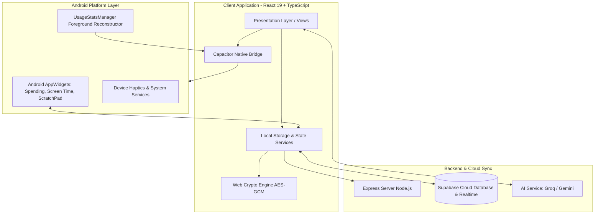

# Zikenn Dashboard

> **Your life, career, and finances in one command center.**

Zikenn Dashboard is a personal productivity, life-management, and self-organization platform available as a modern web application and an installable native Android application via Capacitor. It combines everyday planning, habit building, goal setting, financial tracking, digital wellbeing analytics, and career portfolio management into a private, local-first workspace.

---

## Table of Contents

- [Overview and Core Value](#overview-and-core-value)
- [Key Features by Category](#key-features-by-category)
  - [Command Center and Daily Pulse](#command-center-and-daily-pulse)
  - [Productivity, Habits, Goals, and Scheduling](#productivity-habits-goals-and-scheduling)
  - [Personal Finance and Spending Management](#personal-finance-and-spending-management)
  - [Screen Time and Android Widgets](#screen-time-and-android-widgets)
  - [AI Assistant and Supported Integrations](#ai-assistant-and-supported-integrations)
  - [Career, Learning, Knowledge, and Vault](#career-learning-knowledge-and-vault)
- [Web and Android Capabilities](#web-and-android-capabilities)
- [Privacy, Security, Storage, and Synchronization](#privacy-security-storage-and-synchronization)
- [Technology Stack](#technology-stack)
- [System Architecture](#system-architecture)
- [Prerequisites and Local Setup](#prerequisites-and-local-setup)
- [Environment Configuration and Secret Management](#environment-configuration-and-secret-management)
- [Android Development and APK Build](#android-development-and-apk-build)
- [Testing and Quality Assurance](#testing-and-quality-assurance)
- [Project Structure](#project-structure)
- [Roadmap](#roadmap)
- [Contributing and License](#contributing-and-license)

---

## Overview and Core Value

Modern productivity often requires managing multiple fragmented utilities: a to-do list, habit tracker, budgeting spreadsheet, password vault, personal journal, and screen-time settings.

Zikenn Dashboard consolidates these workflows into a single unified interface:

- **Single Workspace:** Manage daily execution, long-term ambitions, and finances without switching across different websites and apps.
- **Local-First Reliability:** Runs entirely client-side with offline storage and optional cloud persistence through Supabase.
- **Hardware Integration on Android:** Integrates with Android's `UsageStatsManager` for authentic screen-time tracking and provides home-screen AppWidgets for quick glanceability.
- **Client-Side Data Protection:** Cryptographically secures sensitive credentials and journal entries before writing to local or remote storage.

---

## Key Features by Category

### Command Center and Daily Pulse
- **Modular Dashboard Grid:** Real-time digital clock, cross-device alarms, and daily quote generator.
- **Calendar & Panchang:** Traditional Indian calendar and Panchang integrations paired with standard Gregorian schedule views.
- **Time-Blocked Daily Schedule:** Hourly timeline for managing focused work sessions and appointments.
- **Quick-Capture Bar:** Capture tasks, quick thoughts, and expenses from anywhere in the app with keyboard shortcuts.

### Productivity, Habits, Goals, and Scheduling
- **Draggable Kanban Board:** Organize tasks into Backlog, In Progress, Review, and Done columns with priority tagging, search filters, and checklist items.
- **Habit Consistency Matrix:** Track daily routines across a weekly grid with streak calculation, completion rate analytics, and streak preservation.
- **Goals and Milestones:** Define multi-step life goals with target deadlines, category groupings, and visual percentage completion bars.
- **Unified Trash System:** Soft-delete engine supporting item recovery and permanent purging across tasks, habits, and notes.

### Personal Finance and Spending Management
- **Expense & Income Ledger:** Record daily financial movements with categories, payment methods, merchant details, and cashflow indicators.
- **Subscription Tracker:** Track recurring weekly, monthly, and annual commitments, renewal dates, and projected subscription spending.
- **CSV & Excel Import/Export:** Import bank and card statements via an integrated parser and export transaction histories to standard formats.
- **Native Android Spending Widget:** `SpendingWidgetProvider` renders daily and weekly spending totals directly on the Android home screen with deep links to log transactions.

### Screen Time and Android Widgets
- **Authoritative Interval Union:** On Android devices, reconstructs daily app usage from native `UsageEvents` using mathematical interval unions to avoid multi-window and picture-in-picture inflation.
- **24-Hour Hourly Breakdown:** Hourly bar charts illustrating usage distribution across the day.
- **Cross-Platform Synchronization:** Background bridge synchronizes native APK screen-time statistics to web sessions via secure local and cloud storage.
- **Native Android Screen Time Widget:** `ScreenTimeWidgetProvider` displays daily screen time on the home screen, updating automatically across midnight boundaries.
- **Android ScratchPad Widget:** `ScratchPadWidgetProvider` enables reading and editing quick notes directly from the home screen without launching the full app.

### AI Assistant and Supported Integrations
- **Conversational Productivity Assistant:** Integrated assistant capable of parsing plain-text requests into structured tasks, habit updates, and expense entries.
- **Provider Flexibility:** Built-in adapter for Groq (`llama-3.3-70b-versatile`) and Google Gemini models via `@google/genai`.
- **Zero Hallucination Actions:** Dispatches standard internal application events rather than writing directly to database tables, guaranteeing data schema integrity.

### Career, Learning, Knowledge, and Vault
- **Professional Workfolio & Portfolio:** Showcase professional projects, work milestones, skills taxonomy, and downloadable resume drafts.
- **Exam Preparation Center:** Target topic checklists, syllabus coverage tracking, exam date countdowns, and revision logs.
- **Encrypted Password Vault:** Stores logins, recovery codes, and secret notes protected by AES-GCM client-side encryption.
- **Dear Diary Journal:** Rich markdown personal diary featuring mood tracking, tags, search, and private encrypted entries.
- **Media Gallery:** Organize personal images, reference graphics, and visual inspiration with categorised folders.

---

## Web and Android Capabilities

| Capability | Web Application (Browser / PWA) | Native Android APK (Capacitor) |
| :--- | :--- | :--- |
| **Platform Target** | Modern desktop and mobile browsers | Android 7.0+ (API 24+) |
| **Packaging** | Vite SPA, served via Node.js Express | APK / Android App Bundle (AAB) |
| **Offline Support** | LocalStorage + Web Cache | Full offline resilience via Capacitor storage |
| **Home-Screen Widgets** | Not available (browser limitation) | Native AppWidgets (Spending, Screen Time, ScratchPad) |
| **Screen Time Source** | Synced snapshot from Android APK | Hardware `UsageStatsManager` via custom native plugin |
| **Haptic Feedback** | Fallback / Web Vibration API | Native hardware haptics via `@capacitor/haptics` |
| **Data Encryption** | Web Crypto API (AES-GCM) | Web Crypto API (AES-GCM) |
| **Cloud Synchronization** | Supabase Realtime WebSocket | Supabase Realtime WebSocket |

---

## Privacy, Security, Storage, and Synchronization

- **Client-Side Cryptography:** Master passwords derive cryptographic keys using PBKDF2/SHA-256. Vault credentials and private journal records are encrypted using AES-GCM before writing to storage.
- **Local-First Architecture:** The application remains fully functional without a network connection. All data writes immediately to localStorage/IndexedDB.
- **Selective Cloud Synchronization:** If configured with Supabase credentials, records synchronize seamlessly across authenticated devices via real-time WebSocket subscriptions.
- **Zero Analytics Tracking:** No third-party behavioral analytics, telemetry collectors, or ad networks are bundled into the codebase.

---

## Technology Stack

### Frontend Application
- **Framework:** React 19 with TypeScript 5
- **Build System:** Vite 7 with `@vitejs/plugin-react`
- **Styling:** Tailwind CSS 4 with `@tailwindcss/vite`
- **Motion & Animations:** Motion (Framer Motion 12)
- **UI Primitives:** Radix UI (`@radix-ui/react-*`), Lucide React icons
- **Data & Charts:** Recharts 2, DayPicker 9

### Mobile Shell & Plugins
- **Runtime:** Capacitor 8 (`@capacitor/core`, `@capacitor/android`)
- **Native Plugins:** App, Haptics, Keyboard, Network, Share, Splash Screen, Status Bar
- **Custom Android Code:** Java-based plugins for `UsageStatsManager` and Android AppWidgets

### Backend & Cloud Sync
- **Backend Server:** Node.js Express 4 (`server/index.ts`)
- **Database & Sync:** Supabase JS 2 (`@supabase/supabase-js`)
- **Language Models:** Groq SDK / `@google/genai` TypeScript SDK

---

## System Architecture



---

## Prerequisites and Local Setup

### Prerequisites
- **Node.js:** v18.0.0 or later (v20+ recommended)
- **npm:** v9.0.0 or later (bundled with Node.js)
- **Git**

### Installation Steps

1. Clone the repository:
   ```bash
   git clone https://github.com/your-username/personal-dashboard.git
   cd personal-dashboard
   ```

2. Install dependencies:
   ```bash
   npm install
   ```

3. Start the local development server:
   ```bash
   npm run dev
   ```
   The application will be accessible at `http://localhost:3000`.

4. Build production assets:
   ```bash
   npm run build
   ```

5. Run the production Node.js server:
   ```bash
   npm start
   ```

---

## Environment Configuration and Secret Management

Copy `.env.example` to create your local `.env` file:

```bash
cp .env.example .env
```

### Environment Variables

| Variable | Scope | Required | Purpose |
| :--- | :--- | :---: | :--- |
| `VITE_SUPABASE_URL` | Client (Public) | Optional | Supabase project URL for cloud synchronization |
| `VITE_SUPABASE_ANON_KEY` | Client (Public) | Optional | Supabase anonymous public key |
| `VITE_GROQ_API_KEY` | Client (Optional) | Optional | Groq API key for conversational AI assistance |
| `GEMINI_API_KEY` | Server (Private) | Optional | Server-side Gemini API access key |

*Security Note:* Variables prefixed with `VITE_` are bundled into the client build. Never place private administrative keys (such as `SUPABASE_SERVICE_ROLE_KEY`) in client environment variables. When no cloud keys are provided, the application operates purely in offline local storage mode.

---

## Android Development and APK Build

### Prerequisites for Android
- Android Studio Iguana or newer
- Java Development Kit (JDK 17 or JDK 21)
- Android SDK (API Level 34 / 35 recommended)

### Build Workflow

1. Build the web distribution and synchronize Capacitor assets:
   ```bash
   npm run cap:build
   ```

2. Open the project in Android Studio:
   ```bash
   npm run cap:open
   ```

3. Assemble a debug APK from the terminal:
   ```bash
   cd android
   ./gradlew assembleDebug
   ```
   The compiled APK will be located at:
   `android/app/build/outputs/apk/debug/app-debug.apk`

4. Deploy directly to a connected device via ADB:
   ```bash
   adb install -r android/app/build/outputs/apk/debug/app-debug.apk
   ```

---

## Testing and Quality Assurance

The repository includes a comprehensive test suite covering data structures, cross-platform synchronization, storage integrity, and business logic:

```bash
# Execute the full Vitest automated test suite
npm run test

# Run TypeScript compiler type-checking without emitting files
npm run check

# Execute linter checks
npm run lint

# Auto-format codebase using Prettier
npm run format
```

---

## Project Structure

```
personal-dashboard/
├── android/                   # Native Android Capacitor project
│   ├── app/src/main/
│   │   ├── java/.../          # Native plugins (ScreenTime, SpendingWidget, etc.)
│   │   └── res/               # Android layouts, AppWidget XMLs, and drawables
├── client/                    # React 19 Frontend application
│   ├── public/                # Static assets, PWA icons, and brand graphics
│   └── src/
│       ├── assets/            # Embedded illustrations and background covers
│       ├── components/        # View modules (Dashboard, Tasks, Habits, Expenses, Vault)
│       ├── presentation/      # Responsive adapters and mobile screen wrappers
│       ├── services/          # ScreenTime, SMS parsing, and AppWidget synchronization
│       ├── utils/             # Web Crypto, storage adapters, audio soundscapes
│       └── types.ts           # Shared TypeScript domain definitions
├── server/                    # Node.js Express server entry point
├── package.json               # NPM scripts and dependency specifications
├── tsconfig.json              # TypeScript compilation configuration
└── vite.config.ts             # Vite bundler configuration
```

---

## Roadmap

- [x] Unified life dashboard and customizable widget layout
- [x] Draggable Kanban boards with status columns and task checklists
- [x] Weekly habit consistency matrix with celebratory triggers
- [x] Client-side AES-GCM encrypted password vault and private diary
- [x] Personal spending tracker with recurring subscription management
- [x] Native Android Capacitor build with Spending, Screen Time, and ScratchPad widgets
- [x] Authoritative Android Screen Time calculation via `UsageEvents` interval unions
- [ ] End-to-end encrypted peer sync using WebRTC
- [ ] Biometric authentication (Fingerprint / Face Unlock) for native Android vault access
- [ ] Recurring scheduled budget alerts and category spending limits

---

## Contributing and License

Contributions, bug reports, and suggestions are welcome. Please ensure that:
1. Code conforms to TypeScript strict mode (`npm run check`).
2. All unit and integration tests pass (`npm run test`).
3. Code adheres to existing formatting conventions (`npm run format`).

This project is licensed under the **[MIT License](LICENSE)**.
