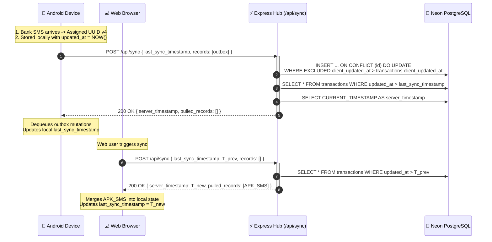

<div align="center">

# 🪐 Zikenn Dashboard (LifeOS v4)

**Your life, career, finances, and digital wellbeing in one private, unified command center.**

[](https://react.dev/)
[](https://www.typescriptlang.org/)
[](https://vitejs.dev/)
[](https://capacitorjs.com/)
[](https://neon.tech/)
[](https://tailwindcss.com/)
[](https://vitest.dev/)
[](LICENSE)

<br/>

[✨ Features](#-core-features) • [⚡ Delta Sync Architecture](#-timestamp-based-delta-sync-architecture) • [📱 Android Native APK](#-android-native-deep-integration) • [🚀 Quick Start](#-quick-start-guide) • [🛠️ Tech Stack](#%EF%B8%8F-technology-stack) • [🧪 Testing](#-testing--quality-assurance)

<br/>

</div>

---

## 💡 What is Zikenn Dashboard?

**Zikenn Dashboard** is a local-first personal productivity, life operating system, and financial tracking hub. Built with **React 19**, **TypeScript**, **Capacitor 8**, and backed by a high-performance **Node.js / Express** server connected to **Neon Serverless PostgreSQL**.

It solves productivity fragmentation by combining:
- 💰 **Automated SMS Financial Ledger** with bank auto-logging on Android.
- ⚡ **Timestamp-Based Delta Sync** with UUID v4 primary keys and conflict-free multi-device reconciliation.
- ⏱️ **Real Hardware Screen Time Tracking** via Android's native `UsageStatsManager`.
- 🔐 **Military-Grade Vault** protected by client-side AES-GCM-256 encryption.
- 🎯 **Habits, Tasks & Milestone Roadmaps** with streak analytics.
- 🧠 **AI Copilot** powered by Google Gemini (Live WebSocket & Tool Calling) and Groq.
- 📅 **Dual Gregorian & Indian Panchang Calendars** with festival notifications.

Available simultaneously as a high-speed **Progressive Web App** and an installable **Native Android APK**.

---

## 🌟 Key Highlights & Why It's Different

| Feature | Standard Productivity Apps | Zikenn Dashboard |
| :--- | :--- | :--- |
| **Data Ownership** | 🔒 Cloud lock-in, vendor databases | 🏠 **Local-first durability**, works 100% offline |
| **Financial Logging** | ✍️ Manual entry or paid aggregators | ⚡ **Automatic bank SMS logging** on Android (Free & Private) |
| **Sync Architecture** | 🐢 Full-snapshot overwrites, collisions | 🚀 **UUID v4 Timestamp Delta Sync** on Neon Postgres |
| **Digital Wellbeing** | 📱 Inaccurate browser estimates | 📊 **Hardware-level Android `UsageStatsManager`** statistics |
| **Security** | 🔑 Server-side plaintext or reversible hashes | 🛡️ **Zero-knowledge AES-GCM-256 client encryption** |
| **AI Integration** | 🤖 Chatbots disconnected from app state | 🧠 **Structured AI tool-calling engine** mapped to actions |

---

## 🎁 Core Features

### 💰 Financial Command Center & SMS Auto-Logging
* **Native Android SMS Auto-Parsing:** Background capture of transactional bank SMS messages (ICICI, HDFC, SBI, Axis, Kotak, UPI, credit/debit cards).
* **Instant Device-Side UUID v4 Assignment:** Transactions are assigned an RFC 4122 v4 UUID the moment they arrive on device, preventing duplicate generation or cloud race conditions.
* **Deterministic Deduplication:** Multi-stage fingerprinting combining transaction timestamp, reference IDs (UTR, UPI, SMS Reference), and merchant matching.
* **Dual-Direction Bookkeeping:** Automatic classification of `DEBIT` and `CREDIT` cash flows, salary deposits, refunds, and investments.
* **Excel / CSV Statement Importer:** Bulk upload bank statements with automated column mapping, preview reconciliation, and sheet batch management.
* **Smart Analytics:** Spending breakdown by category, monthly trend forecasts, and home-screen spending widgets.

### ⚡ Timestamp-Based Delta Sync Architecture
* **Neon Serverless PostgreSQL Engine:** Cloud persistence powered by Neon's serverless connection pooler.
* **UUID v4 Primary Keys:** Zero auto-incrementing integer collisions across distributed clients.
* **Incremental Delta PUSH & PULL:** Clients only transmit modified records (outbox mutations) and only receive changes that occurred after `last_sync_timestamp`.
* **Conflict Resolution (Last-Write-Wins):** Intelligent server-side timestamp comparison (`updated_at` / `client_updated_at`) ensures stale offline writes cannot overwrite newer online modifications.
* **Soft-Deletion & Tombstones:** Deleted transactions carry `is_deleted: true` tombstones with automated garbage collection and Trash recovery.

### 📱 Android Native Deep Integration (Capacitor 8)
* **Real Hardware Screen Time:** Powered by a native Capacitor plugin invoking Android's `UsageStatsManager` for true app usage, unlocks, and digital wellbeing trends.
* **Native Home-Screen Widgets:** Quick expense logger, real-time screen time widget, and sticky ScratchPad note.
* **SMS Broadcast Receiver:** Background Android service that detects incoming SMS notifications and triggers local storage persistence.
* **Native Haptic Feedback:** Tactile haptic confirmations for button taps, completed habits, and expense entries.

### 🧠 AI Productivity Copilot
* **Google Gemini Integration:** Gemini Live WebSocket streaming and structured multi-turn conversation.
* **Groq Ultra-Fast Execution:** Sub-second command parsing using LLaMA models on Groq LPUs.
* **Intent Routing Engine:** Converts plain English commands into validated dashboard operations (e.g., *"Log 350 for dinner with Arpita via UPI"* or *"Add gym workout to daily schedule"*).

### 🎯 Habits, Tasks & Life Goals
* **Weekly Habit Matrix:** 7-day completion grid with automated Monday rollover, streak preservation, and activity history.
* **Visual Kanban Task Board:** Drag-and-drop tasks with priorities, status columns (`Todo`, `In Progress`, `Review`, `Done`), and due-date filters.
* **Milestone Roadmaps:** Break down multi-year goals into actionable milestones with visual progress indicators.

### 🔐 Zero-Knowledge Encrypted Vault
* **AES-GCM-256 Encryption:** Vault passwords, API credentials, and recovery codes are encrypted on the client before being written to disk or synced.
* **PBKDF2 Key Derivation:** Master PIN/passwords derived with salt and thousands of hashing iterations.

---

## ⚡ Timestamp-Based Delta Sync Architecture

The system utilizes an optimistic, local-first bidirectional delta sync engine:



### Database Schema Highlights (`transactions` Table)

```sql
CREATE TABLE IF NOT EXISTS public.transactions (
    id UUID PRIMARY KEY DEFAULT gen_random_uuid(),
    workspace_identifier TEXT NOT NULL,
    user_email TEXT,
    name TEXT NOT NULL,
    amount NUMERIC(12, 2) NOT NULL,
    category TEXT NOT NULL,
    date TEXT NOT NULL,
    time TEXT,
    direction TEXT NOT NULL DEFAULT 'DEBIT',
    payment_method TEXT,
    billing_cycle TEXT,
    notes TEXT,
    bank_name TEXT,
    masked_account TEXT,
    account_last4 TEXT,
    reference_id TEXT,
    sms_reference_id TEXT,
    upi_reference TEXT,
    raw_sms_text TEXT,
    merchant TEXT,
    payee TEXT,
    source TEXT,
    active BOOLEAN NOT NULL DEFAULT TRUE,
    is_deleted BOOLEAN NOT NULL DEFAULT FALSE,
    deleted_at TIMESTAMPTZ,
    created_at TIMESTAMPTZ NOT NULL DEFAULT CURRENT_TIMESTAMP,
    updated_at TIMESTAMPTZ NOT NULL DEFAULT CURRENT_TIMESTAMP,
    client_updated_at BIGINT NOT NULL DEFAULT 0,
    version BIGINT NOT NULL DEFAULT 1
);

-- Optimized Indexes for Delta Sync
CREATE INDEX idx_transactions_delta_sync ON public.transactions(workspace_identifier, updated_at);
CREATE INDEX idx_transactions_active_sync ON public.transactions(workspace_identifier, is_deleted);
```

---

## 🛠️ Technology Stack

```
┌─────────────────────────────────────────────────────────────────┐
│                       🎨 FRONTEND LAYER                         │
├─────────────────────────────────────────────────────────────────┤
│  React 19 • TypeScript 5.8 • Vite 7.3 • Tailwind CSS 4.0        │
│  Radix UI Primitives • Lucide Icons • SheetJS (xlsx) • Sonner   │
└────────────────┬────────────────────────────────────────────────┘
                 │
┌────────────────▼────────────────────────────────────────────────┐
│                   📱 NATIVE ANDROID RUNTIME                     │
├─────────────────────────────────────────────────────────────────┤
│  Capacitor 8.5 • Android SDK 34 • UsageStatsManager Screen Time  │
│  Custom SMS BroadcastReceiver • AppWidgets • Native Haptics     │
└────────────────┬────────────────────────────────────────────────┘
                 │
┌────────────────▼────────────────────────────────────────────────┐
│                   ⚡ BACKEND & CLOUD HUB                         │
├─────────────────────────────────────────────────────────────────┤
│  Node.js 20+ • Express.js • WebSocket (ws) • Google GenAI SDK   │
│  Bidirectional Delta Sync (/api/sync) • Gemini Live Proxy       │
└────────────────┬────────────────────────────────────────────────┘
                 │
┌────────────────▼────────────────────────────────────────────────┐
│                    🐘 DATABASE & PERSISTENCE                    │
├─────────────────────────────────────────────────────────────────┤
│  Neon Serverless PostgreSQL (pgcrypto, UUID v4, TIMESTAMPTZ)    │
│  IndexedDB & LocalStorage Client Cache • Client AES-GCM Vault   │
└─────────────────────────────────────────────────────────────────┘
```

---

## 🚀 Quick Start Guide

### Prerequisites
- [Node.js](https://nodejs.org/) (v18.0.0 or higher, Node 20+ recommended)
- [npm](https://www.npmjs.com/) or [pnpm](https://pnpm.io/)
- For Android builds: [Android Studio](https://developer.android.com/studio) with Android SDK 34+

### 1. Clone the Repository
```bash
git clone https://github.com/zikenn26/Personal-Dashboard-v2.git
cd Personal-Dashboard-v2
```

### 2. Install Dependencies
```bash
npm install
```

### 3. Environment Configuration
Create a `.env` file in the project root:
```env
# Server & Database Configuration
PORT=3000
NODE_ENV=development
DATABASE_URL=postgresql://[USER]:[PASSWORD]@[HOST]/[DB_NAME]?sslmode=require&channel_binding=require

# AI Copilot Keys
GEMINI_API_KEY=your_gemini_api_key_here
GROQ_API_KEY=your_groq_api_key_here

# Optional: CORS allowed origins (comma-separated)
ALLOWED_ORIGINS=http://localhost:3000,http://localhost:5173
```

### 4. Apply Database Migrations (Neon PostgreSQL)
To initialize or migrate the Neon database tables, execute the provided migration script:
```bash
node -e "const { pool } = require('./dist/server/db.js'); /* or execute neon_delta_sync_migration.sql in Neon Console */"
```
*Alternatively, paste the contents of [`neon_delta_sync_migration.sql`](neon_delta_sync_migration.sql) into your Neon SQL Editor console.*

### 5. Run the Application in Development Mode
```bash
# Starts the Vite client and Express API proxy
npm run dev
```
Open your browser at `http://localhost:3000`.

### 6. Build for Production
```bash
# Compiles React via Vite and bundles Express backend via esbuild
npm run build

# Start production server
npm start
```

---

## 📱 Building the Native Android APK

The project includes a complete native Android application configured with Capacitor.

### 1. Synchronize Web Assets to Android
```bash
npm run cap:build
```
*This runs `vite build` and copies the compiled bundle to `android/app/src/main/assets/public`.*

### 2. Open in Android Studio
```bash
npm run cap:open
```

### 3. Build & Run
- Connect your Android device via USB (or start an Android Virtual Device).
- Click **Run (Shift + F10)** in Android Studio.
- Grant **SMS Read Permission** and **Usage Access Permission** in Android Settings when prompted to enable automatic transaction tracking and hardware screen time stats.

---

## 🧪 Testing & Quality Assurance

The codebase includes an extensive automated test suite covering all client utilities, UI calculators, local storage persistence, SMS parsing regexes, and delta sync endpoints.

```bash
# Run full Vitest suite (47 test files, 777 unit & integration tests)
npm test

# Run TypeScript type check
npm run check

# Run end-to-end Neon DB delta sync integration verification
npx tsx server/testEndToEndDeltaSync.ts
```

### Test Coverage Highlights
- ✅ **Delta Sync Architecture:** UUID v4 generation, outbox push, incremental pull, collision detection, and soft-delete propagation ([`deltaSyncArchitecture.test.ts`](client/src/tests/deltaSyncArchitecture.test.ts)).
- ✅ **SMS Transaction Parser:** Over 60+ Indian bank SMS formats verified for debit/credit accuracy ([`bankFormatRegression.test.ts`](client/src/tests/bankFormatRegression.test.ts)).
- ✅ **Local-First Durability:** Offline-first IndexedDB persistence, atomic outbox mutations, and recovery ([`localFirstExpenseSync.test.ts`](client/src/tests/localFirstExpenseSync.test.ts)).
- ✅ **Hardware Screen Time:** App duration parsing, unlock count tracking, and device reconciliation ([`screenTimeCalculation.test.ts`](client/src/tests/screenTimeCalculation.test.ts)).
- ✅ **Client Cryptography:** Zero-knowledge password verification and AES-GCM vault security ([`crypto.test.ts`](client/src/utils/crypto.test.ts)).

---

## 📂 Project Directory Structure

```
Personal-Dashboard-App-GitHub/
├── android/                         # Capacitor Native Android Project
│   ├── app/src/main/java/           # Native Plugins, AppWidgets, & Receivers
│   └── app/src/main/assets/public/  # Synced Web Production Assets
├── client/                          # Frontend Application
│   ├── src/
│   │   ├── components/              # Modular UI Widgets & Section Panels
│   │   ├── presentation/mobile/     # Responsive Mobile Screens & Sheets
│   │   ├── repositories/            # Local-First IndexedDB Expense Repository
│   │   ├── services/                # Sync, Screen Time, Native & SMS Services
│   │   ├── tests/                   # Automated Vitest Test Suites
│   │   ├── utils/                   # Storage, Crypto, UUID, & Export Helpers
│   │   ├── types.ts                 # Central TypeScript Definitions
│   │   └── App.tsx                  # Root Application Component
│   ├── public/                      # Static Assets, Icons & Schema Scripts
│   └── index.html                   # HTML Entrypoint
├── server/                          # Backend Cloud Hub
│   ├── db.ts                        # Neon PostgreSQL Connection Pool
│   ├── syncService.ts               # Bidirectional Delta Sync & Device Hub
│   ├── screenTimeService.ts         # Screen Time Sync Relay
│   ├── geminiService.ts             # Google Gemini Live WebSocket Server
│   ├── security.ts                  # Security Headers & Rate Limiting
│   └── index.ts                     # Main Express Entrypoint
├── neon_schema.sql                  # Production Neon Postgres Schema
├── neon_delta_sync_migration.sql    # UUID Delta Sync SQL Migration
├── package.json                     # Scripts & Dependencies
├── vite.config.ts                   # Vite & PWA Build Configuration
└── README.md                        # Documentation
```

---

## 🔒 Security & Privacy Practices

1. **Zero Data Snooping:** No tracking scripts, no Google Analytics, no third-party telemetry.
2. **Encrypted Vault Storage:** All credentials stored in the Vault are encrypted using standard **AES-GCM (256-bit)** before touching storage or wire.
3. **Optimistic Concurrency Control:** Write mutations include timestamp checks to prevent accidental overwrites when multiple devices update simultaneously.
4. **Authoritative Master Protection:** APK device entries originating from native SMS parsing are protected against destructive browser snapshot overwrites.

---

## 🤝 Contributing

Contributions, feedback, and pull requests are warmly welcome!

1. Fork the Project.
2. Create your Feature Branch (`git checkout -b feature/AmazingFeature`).
3. Commit your Changes (`git commit -m 'feat: Add some AmazingFeature'`).
4. Ensure all tests pass (`npm test && npm run check`).
5. Push to the Branch (`git push origin feature/AmazingFeature`).
6. Open a Pull Request.

---

## 📄 License

Distributed under the **MIT License**. See [`LICENSE`](LICENSE) for more information.

---

<div align="center">

Made with ❤️ for high-performance personal productivity.

</div>
