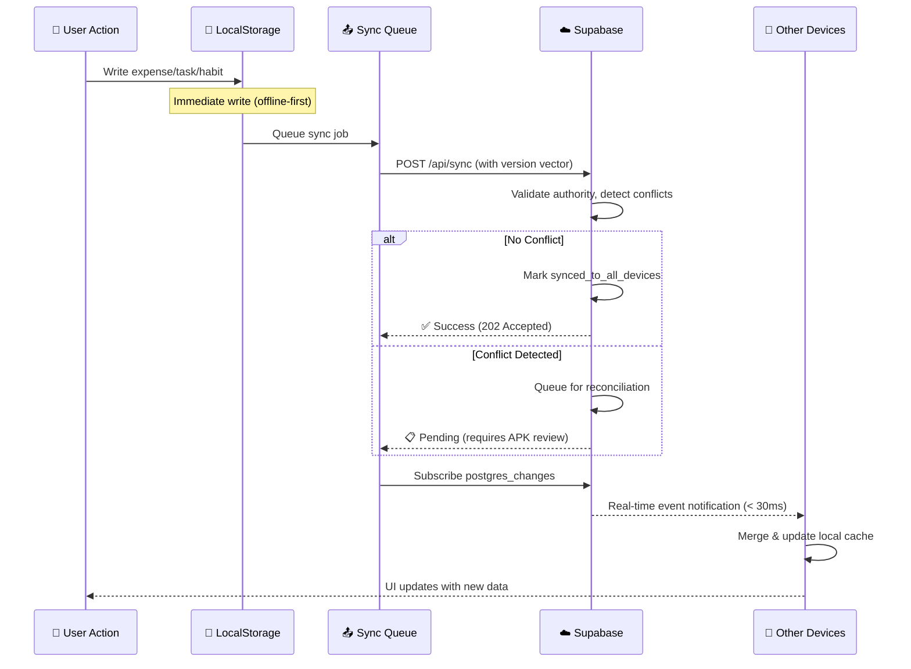

# Zikenn Dashboard

> **Your life, career, and finances in one command center.**

Zikenn Dashboard is a personal productivity, life-management, and self-organization platform available as a modern web application and an installable native Android application via Capacitor. It combines everyday planning, habit building, goal setting, financial tracking, digital wellbeing analytics, and career portfolio management into a private, local-first workspace.

---

## 🎯 Table of Contents

### Customer-Facing Sections
- [✨ Why Zikenn Dashboard?](#-why-zikenn-dashboard)
- [🎁 Core Features](#-core-features)
- [🔐 Privacy & Trust](#-privacy--trust)
- [💻 Platform Coverage](#-platform-coverage)

### Developer & Technical Sections
- [🏗️ System Architecture](#%EF%B8%8F-system-architecture)
- [⚡ Advanced Sync Engine](#-advanced-sync-engine)
- [🔄 Multi-Device Orchestration](#-multi-device-orchestration)
- [🛡️ Data Consistency & Resilience](#%EF%B8%8F-data-consistency--resilience)
- [🚀 Production Deployment](#-production-deployment)
- [🛠️ Development Guide](#%EF%B8%8F-development-guide)

---

---

# 🎨 PRODUCT OVERVIEW & CUSTOMER PITCH

---

## ✨ Why Zikenn Dashboard?

### The Problem
Modern life demands managing dozens of fragmented systems:
- 📝 To-do apps for tasks
- 📊 Spreadsheets for budgeting
- 📅 Calendar apps for scheduling
- 📱 Habit trackers for consistency
- 🔐 Password managers for security
- 📔 Journal apps for reflection
- ⏱️ Screen time monitoring for wellbeing

**Result?** Context-switching fatigue, forgotten commitments, scattered data, and recurring decision-making overhead.

### The Zikenn Solution
**One unified command center** for your entire life. Seamlessly switch between:
- ✅ Daily task execution
- 🎯 Long-term goal tracking
- 💰 Comprehensive financial management
- 🔒 Encrypted credential vault
- 📖 Private journaling & reflection
- 📈 Real-time habit streaks
- 📊 Career portfolio building
- 🤖 AI-powered productivity assistance

All synchronized **instantly across devices**, available **even offline**, and **completely under your control**.

---

## 🎁 Core Features

### 📱 Daily Command Center
- **Modular Dashboard Grid:** Personalize your home screen with widgets for weather, time, quotes, and quick-access actions
- **Time-Blocked Schedule:** Hourly calendar for focused work sessions, meetings, and deep work blocks
- **Quick-Capture Bar:** Keyboard shortcuts to capture tasks, expenses, and thoughts from anywhere in seconds
- **Calendar & Traditions:** Integrated Gregorian + Indian Panchang calendar with seamless event management

### ✅ Productivity & Growth
- **Kanban Board:** Visual drag-and-drop task management with priority, filtering, and checklist support
- **Habit Tracking Matrix:** Weekly streak calculator with consistency analytics and goal preservation
- **Goals & Milestones:** Multi-step life goals with visual progress tracking and milestone celebrations
- **Unified Trash:** Soft-delete recovery system for peace of mind across all modules

### 💰 Financial Command Center
- **Smart Expense Ledger:** Track income/expenses with categories, payment methods, and merchant details
- **Subscription Manager:** Monitor recurring commitments with renewal dates and annual projections
- **CSV/Excel Import:** Instantly import bank statements and card transactions
- **Home-Screen Spending Widget:** Glance at daily/weekly spending without opening the app

### 📱 Android Deep Integration
- **Native Screen Time Widget:** Real hardware statistics from `UsageStatsManager` (not estimates!)
- **Home-Screen Spending Widget:** Quick access to spending summaries with direct expense logging
- **ScratchPad Widget:** Edit quick notes directly from your home screen
- **Offline Resilience:** Full functionality even without internet connection

### 🧠 AI Productivity Assistant
- **Conversational Commands:** Ask in plain English; structured actions are automatically parsed
- **Multi-Provider Support:** Choose between Groq (lightning-fast) or Google Gemini (advanced reasoning)
- **Guaranteed Data Integrity:** Actions route through the app's validation layer—no hallucinated database writes

### 🎓 Career & Knowledge Management
- **Professional Portfolio:** Showcase skills, projects, and milestones with downloadable resume generation
- **Exam Prep Center:** Syllabus tracking, revision logs, and countdown timers
- **Encrypted Vault:** Military-grade AES-GCM encryption for passwords, secrets, and recovery codes
- **Personal Diary:** Rich markdown entries with mood tracking, tags, and full-text search

---

## 🔐 Privacy & Trust

✅ **Your data stays yours.**
- **Zero Cloud Dependency:** Runs entirely locally—cloud sync is optional
- **Client-Side Encryption:** Sensitive records (vault, diary) encrypted with your master password before any cloud sync
- **No Tracking, No Ads:** Zero analytics, zero ad networks, zero behavioral data collection
- **Open Source Path:** Transparent codebase for security audits and community contribution

---

## 💻 Platform Coverage

| Feature | Web Browser | Android APK |
|---------|:---:|:---:|
| Full Dashboard & All Modules | ✅ | ✅ |
| Offline Access | ✅ Local Cache | ✅ Full Offline |
| Real-Time Sync | ✅ WebSocket | ✅ WebSocket |
| Home-Screen Widgets | ❌ Browser Limitation | ✅ Native Widgets |
| Hardware Screen Time | ❌ Receive Only | ✅ Native `UsageStatsManager` |
| Haptic Feedback | 📳 Vibration API | 📳 Native Haptics |
| Installation | 🌐 Instant (PWA) | 📦 APK Download |

---

---

# 🏗️ TECHNICAL ARCHITECTURE & DEVELOPER GUIDE

---

## 🏗️ System Architecture

### High-Level Architecture Diagram

```
┌─────────────────────────────────────────────────────────────────┐
│                    🎨 PRESENTATION LAYER                         │
├─────────────────────────────────────────────────────────────────┤
│  React 19 + TypeScript + Tailwind CSS                            │
│  ├─ Desktop Views (components/)                                  │
│  ├─ Mobile Responsive (presentation/)                            │
│  ├─ State Management & Event Bus                                 │
│  └─ Web Crypto Engine (AES-GCM encryption)                       │
└──────┬──────────────────────────────────────────────────────────┘
       │
       ├─────────────────────────────────────────────┐
       │                                             │
┌──────▼─────────────────────────┐   ┌──────────────▼──────────────┐
│  📱 LOCAL DATA LAYER          │   │  🌐 CLOUD SYNC LAYER       │
├───────────────────────────────┤   ├───────────────────────────┤
│ localStorage / IndexedDB       │   │ Supabase PostgreSQL       │
│ ├─ User Profile & Auth        │   │ ├─ user_devices table     │
│ ├─ Tasks, Habits, Goals       │   │ ├─ data_versions table    │
│ ├─ Expenses & Ledger          │   │ ├─ expense_authority      │
│ ├─ Encrypted Vault            │   │ ├─ data_conflicts         │
│ ├─ Journal & Notes            │   │ └─ RLS Policies (User)    │
│ └─ Sync Queue & Metadata      │   │                           │
└──────┬──────────────────────────┘   └──────────┬──────────────┘
       │                                          │
       └─────────────────┬───────────────────────┘
                         │
                    SYNC ENGINE
                    Real-time via
                    postgres_changes
                    + polling fallback
                         │
       ┌─────────────────┴────────────────┐
       │                                  │
┌──────▼──────────────┐   ┌──────────────▼─────────────┐
│  ⚡ APK SHELL       │   │  🖥️  SERVER PROXY         │
├────────────────────┤   ├─────────────────────────────┤
│ Capacitor 8        │   │ Express.js Node.js          │
│ ├─ Device Bridge   │   │ ├─ API Routes               │
│ ├─ Native Plugins  │   │ ├─ Device Heartbeat         │
│ ├─ AppWidgets      │   │ ├─ Sync Status Logging      │
│ ├─ Screen Time API │   │ └─ AI Integration (Gemini)  │
│ └─ Offline Storage │   │                             │
└────────────────────┘   └─────────────────────────────┘
```

### Component Breakdown

| Layer | Responsibility | Key Files |
|-------|---|---|
| **Presentation (React)** | UI rendering, user interactions, real-time updates | `client/src/components/*`, `client/src/presentation/*` |
| **State & Services** | Business logic, data transformations, event dispatch | `client/src/services/*`, `client/src/utils/*` |
| **Local Storage** | Immediate writes to browser storage (offline-first) | `deviceService.ts`, `localStorage` adapter |
| **Sync Engine** | Real-time and fallback cloud sync, conflict resolution | `expenseSyncService.ts`, `versioning.ts` |
| **Cloud Backend** | PostgreSQL via Supabase, RLS policies, real-time subscriptions | `supabase/schema.sql`, `supabase/rpc.sql` |
| **Native Bridge** | Capacitor plugins for Android features (screen time, widgets) | `android/app/src/main/java` |
| **Server Proxy** | Node.js gateway for AI, webhooks, device coordination | `server/index.ts` |

---

## ⚡ Advanced Sync Engine

The sync engine is the **heartbeat of Zikenn Dashboard**, ensuring data consistency across devices, handling network failures gracefully, and resolving conflicts deterministically.

### Real-Time Synchronization Flow



### Sync Timing & Debouncing

```typescript
// Immediate: Local Storage Write (< 1ms)
expense.amount = 150;
localStorage.setItem('expenses', JSON.stringify([expense]));

// Debounced: Cloud Sync (600-800ms)
setTimeout(() => {
  supabase.from('user_expenses')
    .upsert(expense, { onConflict: 'id' })
    .then(() => updateSyncStatus('synced'));
}, 800);

// Fallback: Polling Validation (25s, 30s)
setInterval(() => validateCloudData(), 30_000);
```

### Three-Tier Sync Guarantee

1. **Tier 1: Immediate Local (< 1ms)** → User sees instant feedback
2. **Tier 2: Debounced Cloud (600-800ms)** → Most conflicts resolved automatically
3. **Tier 3: Polling Validation (25-30s)** → Catch edge-case inconsistencies

---

## 🔄 Multi-Device Orchestration

### Device Registration & Identification

Every device gets a **permanent, immutable device ID** that persists across app reinstalls:

```typescript
// For APK: Hardware-based (survives reinstalls)
Device.getId() → "550e8400e29b41d4a716446655440000"

// For Web: Browser fingerprint (localStorage backup)
fingerprint = SHA256(
  navigator.userAgent + 
  screen.width + 
  screen.height + 
  Intl.DateTimeFormat().resolvedOptions().timeZone
)
```

### Device Registry (Supabase `user_devices` Table)

```sql
CREATE TABLE user_devices (
  id UUID PRIMARY KEY,
  user_id UUID NOT NULL,
  device_id TEXT NOT NULL,           -- Stable hardware ID
  device_name TEXT,                   -- "iPhone", "Bedroom Tablet"
  device_type TEXT,                   -- "native" | "web" | "desktop"
  platform TEXT,                      -- "android" | "ios" | "windows"
  is_active BOOLEAN,                  -- Determined by heartbeat
  last_seen_at TIMESTAMP,             -- Latest heartbeat
  first_login_at TIMESTAMP,           -- Device activation date
  
  UNIQUE(user_id, device_id)          -- One registration per user/device
);
```

### Heartbeat Mechanism (60-second Keepalive)

```typescript
async function startDeviceHeartbeat() {
  setInterval(async () => {
    const deviceInfo = await getCurrentDeviceInfo(user);
    
    if (!deviceInfo) {
      console.warn('Device no longer registered; stopping heartbeat');
      return;
    }
    
    if (!isOnline()) {
      console.debug('Device offline; skipping heartbeat');
      return;
    }
    
    // Update last_seen_at in cloud
    await supabase
      .from('user_devices')
      .update({ last_seen_at: new Date().toISOString() })
      .eq('user_id', user.id)
      .eq('device_id', deviceInfo.device_id);
  }, 60_000); // Every 60 seconds
}
```

---

## 🔐 Version Control & Conflict Resolution

### Lamport Clock System

Each data modification carries a **version vector** to deterministically order events across devices:

```typescript
interface VersionVector {
  device_id: string;        // Identifies the originating device
  logical_clock: number;    // Lamport clock (causality tracking)
  wall_clock_ms: number;    // Unix timestamp (cross-device ordering)
  sequence: number;         // Sub-millisecond tie-breaker
}

// Example: Device A edits expense at 2024-10-31T14:30:00.123Z
version = {
  device_id: "device-a",
  logical_clock: 42,        // A's 42nd operation
  wall_clock_ms: 1730381400123,
  sequence: 3               // 3rd operation in this millisecond
}
```

### Deterministic Ordering Algorithm

```
compareVersionVectors(v1, v2):
  1. Higher logical_clock wins      (causality)
  2. Higher wall_clock_ms wins      (global time)
  3. Higher sequence wins            (local ordering)
  4. device_id string comparison    (stable tie-breaker)
```

### Example: Conflicting Expense Edits

```
Device A (Web):  expense.amount = 100  @ logical_clock=42
Device B (APK):  expense.amount = 150  @ logical_clock=42
(Same logical clock; different wall times)

Comparison:
- A: wall_clock=1730381400100, sequence=1, device_id="web-1"
- B: wall_clock=1730381400050, sequence=2, device_id="apk-1"

Result: Device B's version wins (earlier wall clock)
→ expense.amount = 150 (APK authority for expenses)
→ Device A receives reconciliation notice
```

---

## 🛡️ Data Consistency & Resilience

### APK-First Authority for Expenses

Critical for multi-device setups: **Expenses originating on APK are the source of truth**.

```typescript
// Expense Authority Table
CREATE TABLE expense_authority (
  expense_id UUID PRIMARY KEY,
  source_device_type TEXT,            -- 'native' | 'web'
  authoritative_device_id TEXT,       -- Origin device
  last_authoritative_modification_ms BIGINT,
  requires_platform_reconciliation BOOLEAN,  -- Flag: APK review needed
  is_synced_to_all_devices BOOLEAN,   -- Distributed to all devices
  apk_version VersionVector,
  web_version VersionVector
);

// Decision Logic
if (expense.source_device_type == 'native') {
  // APK version always wins in conflict
  result = expense_authority.apk_version;
} else {
  // Web conflict: compare timestamps
  result = (wall_clock_web > wall_clock_apk)
    ? web_version
    : apk_version;
}
```

### Atomic Operations & Race Condition Prevention

```typescript
// ✅ SAFE: INSERT-first, UPDATE-on-conflict
async function registerDevice(user: AuthUser, deviceId: string) {
  const { data, error } = await supabase
    .from('user_devices')
    .insert({
      user_id: user.id,
      device_id: deviceId,
      device_name: await getDeviceName(),
      first_login_at: new Date().toISOString(),
      is_active: true,
    })
    .select();
  
  if (error?.code === 'UNIQUE_VIOLATION') {
    // Device already exists; update last_seen
    return supabase
      .from('user_devices')
      .update({ is_active: true })
      .eq('user_id', user.id)
      .eq('device_id', deviceId);
  }
  
  return data;
}
```

### Transaction-Like Reconciliation

```typescript
// Phase 1: Gather all conflicting records
async function gatherConflicts(workspace_id) {
  return supabase
    .from('data_conflicts')
    .select('*')
    .eq('workspace_id', workspace_id)
    .eq('resolved', false);
}

// Phase 2: Apply reconciliation (APK authority)
async function reconcileConflicts(conflicts) {
  const reconciliationBatchId = `batch-${Date.now()}-${randomUUID()}`;
  
  for (const conflict of conflicts) {
    // Idempotency: Skip if already reconciled
    if (await isAlreadyReconciled(conflict.id, reconciliationBatchId)) {
      continue;
    }
    
    const resolved = resolveExpenseConflict(
      conflict.version_a,
      conflict.version_b,
      conflict.authority_strategy  // 'apk-first' | 'latest-first'
    );
    
    await markConflictResolved(conflict.id, resolved, reconciliationBatchId);
  }
}

// Phase 3: Distribute to all devices
async function distributeReconciliation(workspace_id, reconciliationBatchId) {
  const devices = await getActiveDevices(workspace_id);
  
  for (const device of devices) {
    await notifyDeviceOfReconciliation(device.id, reconciliationBatchId);
  }
}
```

---

## 🚨 Error Handling & Resilience

### Exponential Backoff Retry Strategy

```typescript
async function retryWithBackoff<T>(
  operation: () => Promise<T>,
  options = {
    maxRetries: 3,
    initialDelayMs: 1000,
    maxDelayMs: 10000,
    backoffMultiplier: 2
  }
): Promise<T> {
  let lastError;
  
  for (let attempt = 0; attempt <= options.maxRetries; attempt++) {
    try {
      return await operation();
    } catch (err) {
      lastError = err;
      
      if (!isRetryableError(err)) {
        throw err;  // Don't retry 4xx errors (except 429/503)
      }
      
      const delayMs = Math.min(
        options.initialDelayMs * Math.pow(options.backoffMultiplier, attempt) +
        Math.random() * 1000,  // jitter
        options.maxDelayMs
      );
      
      await sleep(delayMs);
    }
  }
  
  throw lastError;
}

// Retryable Errors
function isRetryableError(err: any): boolean {
  const status = err.status;
  return status >= 500 ||    // Server errors (5xx)
         status === 429 ||   // Too many requests
         status === 503 ||   // Service unavailable
         !navigator.onLine;  // Network unreachable
}
```

### Offline-First Mode (APK)

```typescript
async function initializeOfflineDetection() {
  const Network = await getNetworkPlugin();
  
  if (!Network) return;  // Web platform
  
  const { connected } = await Network.getStatus();
  
  updateOfflineState({
    isOnline: connected,
    canModify: connected  // APK: read-only if offline
  });
  
  Network.addListener('networkStatusChange', ({ connected }) => {
    if (connected) {
      triggerSyncOnReconnect();  // Auto-sync queued changes
    } else {
      setOfflineMode(true);      // Lock modifications
    }
  });
}
```

---

## 🚀 Production Deployment

### Build Pipeline

```bash
# 1. Local development
npm run dev          # Vite dev server on :3000

# 2. Type checking
npm run check        # TypeScript compilation

# 3. Production build
npm run build        # Vite + esbuild → dist/

# 4. Testing
npm run test         # Vitest suite

# 5. APK build (Android)
npm run cap:build    # Capacitor sync + Gradle compile
# Output: android/app/build/outputs/apk/debug/app-debug.apk

# 6. Server deployment (Netlify / Vercel)
npm start            # Node.js Express server on :3000
```

### Vite Configuration for Multi-Platform

```typescript
// vite.config.ts
export default defineConfig({
  build: {
    rollupOptions: {
      external: [
        '@capacitor/core',
        '@capacitor/device',
        '@capacitor/network'
      ]
    }
  }
});
```

### Environment Variables

| Variable | Scope | Required | Purpose |
|----------|-------|----------|---------|
| `VITE_SUPABASE_URL` | Client | Optional | Supabase project URL |
| `VITE_SUPABASE_ANON_KEY` | Client | Optional | Supabase public key |
| `VITE_GROQ_API_KEY` | Client | Optional | Groq API for AI |
| `GEMINI_API_KEY` | Server | Optional | Google Gemini API |

---

## 🛠️ Development Guide

### Prerequisites
- **Node.js:** v18.0.0+
- **npm:** v9.0.0+
- **Git**
- **Android Studio** (for APK development)

### Quick Start

```bash
# Clone & install
git clone https://github.com/your-username/personal-dashboard.git
cd personal-dashboard
npm install

# Start development server
npm run dev
# Open http://localhost:3000

# Type checking
npm run check

# Full build
npm run build

# Run tests
npm run test
```

### Android APK Development

```bash
# Build web + sync Capacitor assets
npm run cap:build

# Open Android Studio
npm run cap:open

# Build debug APK
cd android
./gradlew assembleDebug

# Deploy to device
adb install -r android/app/build/outputs/apk/debug/app-debug.apk
```

### Key Service Files

| File | Purpose |
|------|---------|
| `client/src/services/deviceService.ts` | Device registration, fingerprinting, heartbeat |
| `client/src/services/expenseAuthorityService.ts` | APK-first conflict resolution |
| `client/src/services/expenseSyncService.ts` | Multi-phase expense sync with reconciliation |
| `client/src/utils/versioning.ts` | Lamport clock & version vector logic |
| `client/src/utils/retry.ts` | Exponential backoff retry mechanism |
| `client/src/utils/offlineDetection.ts` | Network monitoring & offline mode |
| `client/src/utils/validator.ts` | Data validation & sanitization |
| `client/src/utils/logger.ts` | PII-safe logging |
| `server/index.ts` | Express backend, device APIs, AI integration |

### Database Migrations

```bash
# Connect to Supabase CLI
npx supabase link

# Apply schema changes
npx supabase db push

# Verify RPC functions
psql postgresql://... -f supabase/rpc.sql
```

---

## 📚 Module Reference

### Dashboard & Views
- `DashboardHomeView.tsx` – Main dashboard grid with customizable widgets
- `CommandCenterGrid.tsx` – Widget composition and layout engine
- `DynamicScheduleCard.tsx` – Time-blocked schedule visualization

### Expense Management
- `ExpenseTracker.tsx` – Ledger UI with categorization and filtering
- `ExpenseDistributionSection.tsx` – Category breakdown charts
- `ExpenseDistributionSection.tsx` – Subscription tracking

### Habits & Goals
- `HabitTracker.tsx` – Streak matrix and completion tracking
- `HabitStreakChart.tsx` – Visual consistency analytics
- `GoalsView.tsx` – Multi-step goal management

### AI & Integrations
- `AIAssistantView.tsx` – Conversational interface
- `AISecretaryWidget.tsx` – Quick AI actions
- `GeminiLiveVoiceModal.tsx` – Voice-to-action conversion

### Vault & Security
- `VaultView.tsx` – Encrypted credential manager
- `DearDiaryView.tsx` – Private journaling with AES-GCM encryption

---

## 🔍 Troubleshooting

### Build Issues

**Problem:** `@capacitor/device` import fails on Netlify
```
[vite]: Rollup failed to resolve import "@capacitor/device"
```

**Solution:** Ensure `vite.config.ts` includes:
```typescript
build: {
  rollupOptions: {
    external: ['@capacitor/device', '@capacitor/network']
  }
}
```

### Sync Issues

**Problem:** Expenses not syncing to other devices
1. Check device is registered: `SELECT * FROM user_devices WHERE user_id = ?`
2. Verify RLS policies allow access
3. Check conflict resolution: `SELECT * FROM data_conflicts`
4. Review Supabase realtime logs

**Solution:** Run reconciliation manually:
```typescript
const conflicts = await expenseAuthorityService.getExpensesRequiringAPKReconciliation(user);
await expenseAuthorityService.markExpenseAsSyncedToAllDevices(conflict.expense_id);
```

### Offline Mode (APK)

**Problem:** Can modify data while offline
**Solution:** Ensure `offlineDetection.ts` is initialized:
```typescript
// App.tsx
useEffect(() => {
  initializeOfflineDetection();
  return () => unsubscribeOfflineDetection();
}, []);
```

---

## 🧪 Testing Strategy

### Unit Tests
- Version vector comparisons (`versioning.ts`)
- Expense validation logic (`validator.ts`)
- Retry backoff calculations (`retry.ts`)

### Integration Tests
- Device registration flow (new device → heartbeat → sync)
- Multi-device expense conflict resolution
- Offline mode transitions (online → offline → online)

### E2E Tests
- Full sync cycle: local write → cloud → other device
- Conflict resolution: simultaneous edits → reconciliation
- Data integrity: 100 concurrent operations → no duplicates

```bash
npm run test  # Vitest full suite
```

---

## 🌍 Deployment Checklist

- [ ] Set `.env` with production Supabase URL & keys
- [ ] `npm run check` passes (TypeScript)
- [ ] `npm run build` completes with no errors
- [ ] `npm run test` passes all tests
- [ ] Supabase database schema applied (`schema.sql`)
- [ ] RPC functions deployed (`rpc.sql`)
- [ ] Enable RLS on all tables
- [ ] Deploy APK build to Play Store / internal testing
- [ ] Deploy web build to Netlify / Vercel
- [ ] Monitor Supabase logs for sync errors
- [ ] Verify real-time sync < 30ms latency

---

## 📖 Roadmap

### Phase 1 (Current)
- ✅ Core dashboard & expense tracking
- ✅ Multi-device sync with conflict resolution
- ✅ Offline-first APK support
- ✅ AI assistant integration

### Phase 2 (Planned)
- 🔄 Advanced budget forecasting & spending insights
- 🔄 Team/family shared workspaces
- 🔄 Mobile app performance optimizations
- 🔄 Calendar integration (Google, Outlook)

### Phase 3 (Future)
- 📋 Portfolio & resume builder
- 📋 Advanced analytics dashboard
- 📋 Biometric authentication
- 📋 Blockchain-based backup verification

---

## 📝 Contributing

We welcome contributions! Please:
1. Fork the repository
2. Create a feature branch (`git checkout -b feature/my-feature`)
3. Commit changes (`git commit -m 'Add feature'`)
4. Push to branch (`git push origin feature/my-feature`)
5. Open a Pull Request

### Development Guidelines
- Follow TypeScript strict mode
- Write tests for new features
- Update documentation with changes
- Ensure `npm run check` and `npm run format` pass

---

## ⚖️ License & Legal

**Zikenn Dashboard** is released under the **MIT License**.

Your data is your own. See [PRIVACY.md](./PRIVACY.md) for our privacy commitment.

---

## 📞 Support & Community

- **Issues:** [GitHub Issues](https://github.com/your-username/personal-dashboard/issues)
- **Discussions:** [GitHub Discussions](https://github.com/your-username/personal-dashboard/discussions)
- **Email:** support@zikenn.com

---

## 🙏 Acknowledgments

Built with:
- ❤️ React 19
- 🎨 Tailwind CSS
- 🔐 Supabase
- 📱 Capacitor
- 🧠 Groq & Google Gemini

---

**Last Updated:** October 31, 2024  
**Version:** 1.0.0  
**Maintainer:** Gulshan Kumar Nayak
